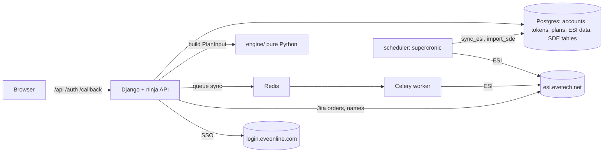

# Context brief: EVE Indy App

Repo: `/home/spud304/python/eveindyapp` (branch `master`, HEAD 497cee2). Read `CLAUDE.md`, `README.md`, `docs/redesign.md` (design source of truth, ~420 lines, contains every decision with dates and source tags) and `docs/ui-design.md` as needed.

## What it is
Industry planning for EVE Online, built around **plans**: "I have these characters, skills, stations and assets (personal and corp). I want to build these things. What's the plan, and where are we on it?" Logs in with EVE SSO, reads characters and corporations through ESI (CCP's API), imports CCP's static data export (SDE).

Features: plans (lines of items → merged build tree), shopping list priced from Jita 4-4 sell orders, blueprints (BPO/BPC/invention, auto-copying, spreading runs over BPCs, opt-in buy BPC/BPO options), schedule across character slots, progress tracking by matching live ESI industry jobs to the active plan, cost (materials + job fees), asset reservation between plans (computed, not stored), compressed ore calculator (LP/MILP via scipy), sharing (corp members log in; link viewers see aliased names), library of blueprints, dashboard.

## Users
- Primary: the owner, a solo developer/industrialist who runs several linked characters (all Directors in their corp), mostly out of corp hangars and corp industry jobs; builds in batches (e.g. 1 Phoenix + 2 Naglfar + 1 Revelation Navy Issue; 10 Ishtar + 50 Hulk; 45–120 Maelstroms).
- Secondary: corpmates viewing shared plans; anyone with a share link (read-only, aliased).
- Design says "for me and anyone with the same use case": signup is open to any EVE account in code.

## Stage
Personal tool, feature-complete through build order steps 0–8. **Runs on localhost only for the owner** (decided 2026-11-04); no server deploy planned, but a production compose stack (Caddy + TLS, web, worker, scheduler, Postgres, Redis) exists and was checked locally. Calibrate: no scaling demands; correctness of plan output matters most (the user buys materials and installs jobs from it). Security matters to the extent of the owner's ESI tokens (Director corp access) and the sharing feature, and to whether the prod stack is safe if deployed later.

## Goals / non-goals
- Goal: one engine result that every tab reads, so views can't disagree; every derived value carries a reason; correct game mechanics (checked against the decompiled client and SDE).
- Non-goals (decided): profit scanner / profit views; plan deadlines; plan editors by others (deferred); paste-import fallback for corp assets (deferred); horizontal scale.

## Stack and architecture
- `backend/`: Python 3.12, Django 5.2 + django-ninja (OpenAPI), Postgres 16, Redis, Celery worker (on-demand syncs), supercronic scheduler (`deploy/crontab`) running management commands.
  - `backend/engine/` — pure planning engine, no Django imports: `types.py` (PlanInput/PlanResult dataclasses), `planner.py` (1646 lines: build/buy decisions, runs, blueprint sources, auto-copy split search `_search_parallel`), `schedule.py`, `formulas.py`, `pricing.py` (Jita repricing), `reprocess.py` (ore LP), `options.py` (buy options).
  - `backend/apps/`: `accounts` (SSO PKCE + JWT, linked characters, encrypted ESI tokens), `esi` (ESI client: ETags, compatibility date, rate limits, breaker), `esidata` (sync of skills/assets/blueprints/jobs/roles, corp feeds, market orders, dashboard/library APIs), `sde` (JSONL import, `gamedata.py` builds engine inputs), `planning` (plans API `plans_api.py`, `inputs.py`, `reservation.py`, `tracker.py`, `sharing.py`, `stations.py`, `ore_api.py`), `core`.
  - Tests: `backend/tests/` (pytest on Postgres; engine tests use a fake game-data builder in `tests/engine/data.py`), `backend/playwright_tests/` (browser tests vs running dev servers; reserved character ids 900000001–099).
- `frontend/`: React 19 + TypeScript + Vite 6, TanStack Router + Query, openapi-fetch with generated types; `src/features/{plans,setup,library,dashboard}`.
- `deploy/`: Dockerfiles, `docker-compose.yml` (prod), `docker-compose.dev.yml` (Postgres 5434, Redis 6381, worker, scheduler), `Caddyfile`, `crontab`, `entrypoint.sh`. CI: `.github/workflows/test.yml`.

## Scope under review
Whole project, current `master`. Core modules to start with: `backend/engine/`, `backend/apps/planning/`, `backend/apps/esidata/`, `backend/apps/accounts/`, `frontend/src/features/plans/`, `deploy/`.
Out of scope: `src/` (an ignored leftover directory of the removed Flask app; not tracked), `venv/`, `staticfiles/`.

## Known open items (already documented; don't report as new unless you have something to add)
- Copies attributed to a plan lose that attribution once delivered; a picked BPC that disappears is silently skipped.
- `_search_parallel` split search is greedy (documented limits).
- Not modelled: facility sccTaxModifier, faction cost modifier, implants, structure build restrictions, per-line cost attribution; every character treated as omega with every activity allowed.
- Plan results and progress are recomputed on every request (no cache, except shared payloads 60 s).
- Janice paste format not checked with a real paste.
- No backup job.

## Unknowns / assumptions
- ASSUMPTION: the owner may deploy the prod stack later; review it as "ready but unused", not as live.
- ASSUMPTION: the dev database holds the owner's real ESI tokens (Director of a corp), so token handling matters even on localhost.
- Unknown: whether engine output has been compared against in-game job windows (docs say "not yet compared" for some values).

## Reviewer constraints
- Read-only. Never use `/auth/dev-login` or touch the account with id 1 (the owner's real data). Don't run anything that calls ESI with real tokens. Running `uv run pytest -q` in `backend/` is allowed only if the dev Postgres is up (port 5434); don't start Docker services.
- Game mechanics claims must be checked against the decompiled client at `/mnt/g/eve projects/src` (`industry/`, `eve/common/script/util/industryCommon.py`) or the imported SDE, or marked inferred.
